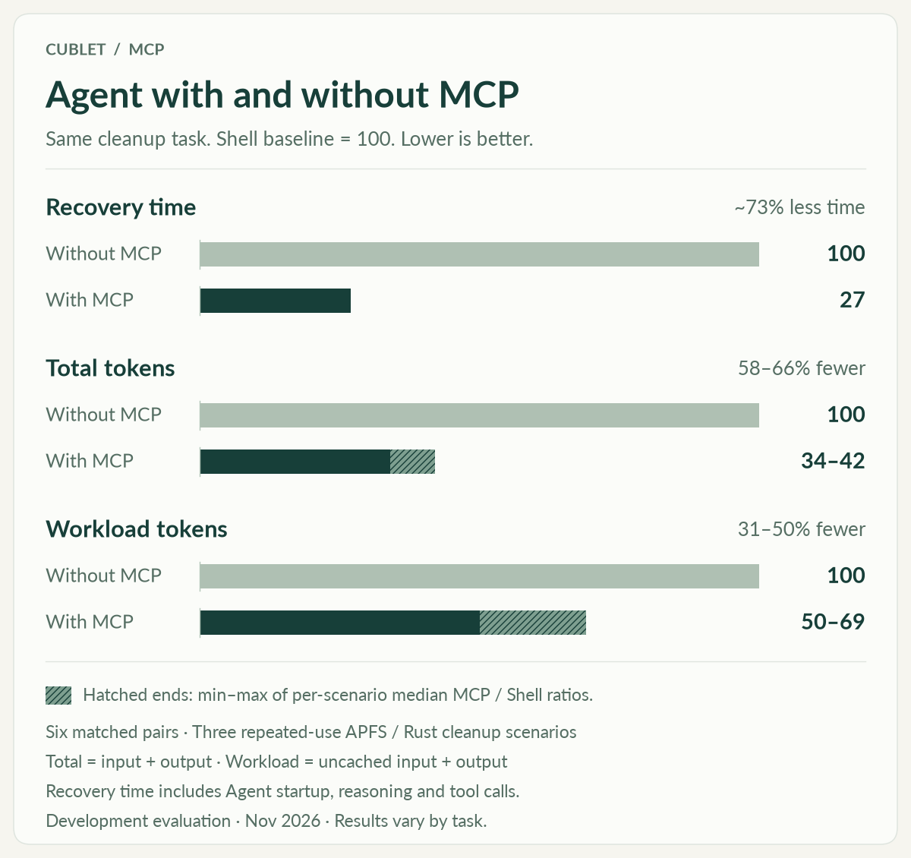

# Cublet

[简体中文](README.zh-CN.md)

**Understand what fills your Mac, what has grown, and what you can remove.**

Cublet is an open-source disk space analyzer for macOS. Explore storage visually, compare saved scans, review applications and their related files, or connect your Agent to local cleanup tools with your authorization.

[Download for macOS](https://cublet.cc/#download) · [Launch article](https://cublet.cc/blog/mac-disk-space/) · [Install & help](https://cublet.cc/help/) · [Release notes](https://cublet.cc/changelog/)


**macOS 13+ · Apple Silicon & Intel · MIT licensed**

[Features](#features) · [Performance](#performance) · [Install](#install) · [Build on macOS](#build-on-macos) · [Contribute](#contribute)

## Features

### See where your space goes

Space Explorer turns allocated disk usage into a proportional treemap. Select a block to inspect its path and usage, drill into folders, browse directory contents in a list, and reveal items in Finder before deciding what to do. Choose a useful scan scope, rescan for a fresh measurement, or stop a running scan.

macOS permissions determine coverage. You can start with basic access or enable Full Disk Access through the app’s guidance. Inaccessible locations and incomplete coverage are reported; they are not counted as empty folders.


### Find what changed

Growth compares the latest completed scan with a retained measurement of the same scope. Investigate the folders that grew, drill into the comparison, and inspect added usage, removed usage and net change separately. Choose a retained baseline instead of guessing from today’s largest folders.

Comparison needs compatible completed scans. A missing baseline is shown explicitly, and older measurements can leave the shared local cache as its budget fills. Moves, renames and hard-link attribution can appear as changes; limited comparisons identify the portion they cover.


### Bring your Agent, with your authorization

Cublet Cleaner exposes local tools through **Model Context Protocol (MCP)**. A compatible client can work toward an available-space target inside an authorized location, using native checks to identify eligible rebuildable Rust targets and Go build caches. Active or uncertain inputs remain protected, and operation receipts distinguish deleted allocation from observed available space. Advanced connections also expose scan, history and preview tools, plus application search and reviewed uninstall.

To connect, open **AI connections → Connection instructions** in the desktop app, then copy its setup prompt to your Agent. Use the executable and arguments supplied by your installed version; the client starts the local process over stdio. The app also shows cleanup history.

Connecting does not authorize deletion. Authorize the task and exact scope before execution. Build-cache recovery permanently removes eligible outputs, which future builds must regenerate. If Settings selects Trash, these tools report a cleanup-mode conflict. Application uninstall supports the selected permanent or Trash mode and requires explicitly authorized items.

Scans and their history stay on your Mac. MCP runs locally, but paths, metadata and receipts returned to your Agent may be processed by its chosen AI provider. See [MCP setup](https://cublet.cc/help/#mcp) and [privacy information](https://cublet.cc/privacy/).

### Review applications and related files

Search Applications by name or path. Full paths distinguish installed copies, renamed backups and discovered builds, so you can review the exact copy you intend to remove. Inspect the app bundle and optional related caches, preferences and app data before confirming the selected items.

Shared or unverified related data is protected with an explanation. Attribution can be incomplete, so review each optional item. Partial results list completed and failed items for another review before retrying.

**Application uninstall defaults to permanent deletion.** Choose **Move to Trash** in Settings if you want selected items retained in Finder Trash. Items in Trash still occupy disk space. Emptying Trash is a separate permanent action.

### Optional Codex tools and preferences

Review local Codex conversation data, linked Git worktrees and cleanup history. Conversation cleanup uses recovery copies; worktree removal has different effects and can discard local files after confirmation. Stop Codex before destructive actions and read the operation-specific warnings.

Settings include English and Simplified Chinese, appearance, disk access and application cleanup mode. Official builds check for and download updates from the release server. Locally packaged builds disable the official updater.

### Read the numbers correctly

| Term | Meaning |
| --- | --- |
| Allocated usage | Space attributed to scanned filesystem entries; it can differ from file size. |
| Available space | The volume’s observed free space; concurrent writes can change it during cleanup. |
| Growth | Change between comparable retained scans, within their measured coverage. |
| Recovered space | Observed available-space change after cleanup; it can differ from deleted allocation. |

APFS clones, snapshots and hard links may retain blocks after removal. A treemap describes the selected scope, which may cover only part of the disk.

## Performance

### Complete Agent cleanup tasks

In a controlled development evaluation on APFS, Cublet MCP used **about 73% less recovery time**, **58–66% fewer total tokens** and **31–50% fewer workload tokens** than the same Agent working through the shell.



| Metric | Cublet MCP, Shell = 100 | Reduction |
| --- | ---: | ---: |
| Recovery time | 27 | About 73% |
| Total tokens | 34–42 | 58–66% |
| Workload tokens | 50–69 | 31–50% |

Six paired repeated-use comparisons covered three cases: nested Rust worktrees, changed scope with stale history, and ongoing writes. Each case uses the median of its paired MCP / Shell ratios. Recovery time includes Agent startup, reasoning and tool calls until sustained free-space recovery. Total tokens = input + output; workload tokens = uncached input + output. Chart ranges span the three case medians, normalized to Shell = 100. These are development results for the tested tasks, not a typical-performance guarantee. See the [method and scope](https://cublet.cc/blog/mac-disk-space/#inside-cublet).

### Native scanner development pilot

The Rust core uses macOS bulk metadata reads, bounded workers and a local SQLite index. Retained measurements support navigation and comparisons; a fresh scan still checks filesystem metadata across the scope.

| Synthetic fixture | Complete scan | Stored measurement restore |
| --- | ---: | ---: |
| 8,329 folders · 643 file entries | 193 ms | 21 ms |
| 52,009 folders · 4,003 file entries | 1,128 ms | 75 ms |

Medians of five cache lifecycles per fixture, measured on one Mac running macOS 26.6.2 in an optimized development build. Each first scan began with an empty 256 MiB application cache and a warm operating-system filesystem cache; restore used a new scanner process. Independent filesystem checks verified totals. These timings measure native scanner requests on the listed fixtures, not UI latency or typical real-world scan speed. [Method](https://cublet.cc/blog/mac-disk-space/#inside-cublet).

## Install

Download the Apple Silicon or Intel DMG from the [official download page](https://cublet.cc/#download), open it, and move Cublet to Applications. Check **Apple menu → About This Mac** if you are unsure which build to choose. Cublet requires macOS 13 or later.

Follow the app’s disk-access guidance. Full Disk Access is managed in **System Settings → Privacy & Security → Full Disk Access**; reopen Cublet if macOS requests it. [Installation and troubleshooting](https://cublet.cc/help/).

## Build on macOS

Install Git, the Xcode Command Line Tools, Node.js 22 or later, and stable Rust with Cargo. Clone the repository so the packaging tools can record the exact source commit.

```sh
git clone https://github.com/Undertone0809/Cublet.git cublet
cd cublet
npm ci --include=dev
npm run build
cargo test --locked --manifest-path rust-core/Cargo.toml -- --test-threads=1

profile=$(mktemp -d "${TMPDIR:-/tmp}/cublet-dev.XXXXXX")
MSM_DISK_CACHE_ROOT="$profile/cache" CODEX_HOME="$profile/codex" \
  npm run electron:dev -- --user-data-dir="$profile/profile"
```

The isolated profile keeps development data separate when testing alongside an installed copy.

For an unsigned local app bundle:

```sh
rustup component add rust-docs
CSC_IDENTITY_AUTO_DISCOVERY=false npm run electron:package
```

The Rust documentation component provides the standard library license files included in the bundle. Local packages have the official updater disabled. To cross-build, install the matching Rust target and set `CUBLET_ARCH=arm64` or `CUBLET_ARCH=x64`.

## Contribute

Read [CONTRIBUTING.md](CONTRIBUTING.md) for tests and issue guidelines. Report vulnerabilities using the [private reporting instructions](SECURITY.md). Cublet is an independent project.

Cublet’s own code uses the [MIT License](LICENSE). The source and distributions retain [third-party notices](THIRD_PARTY_NOTICES.md).
