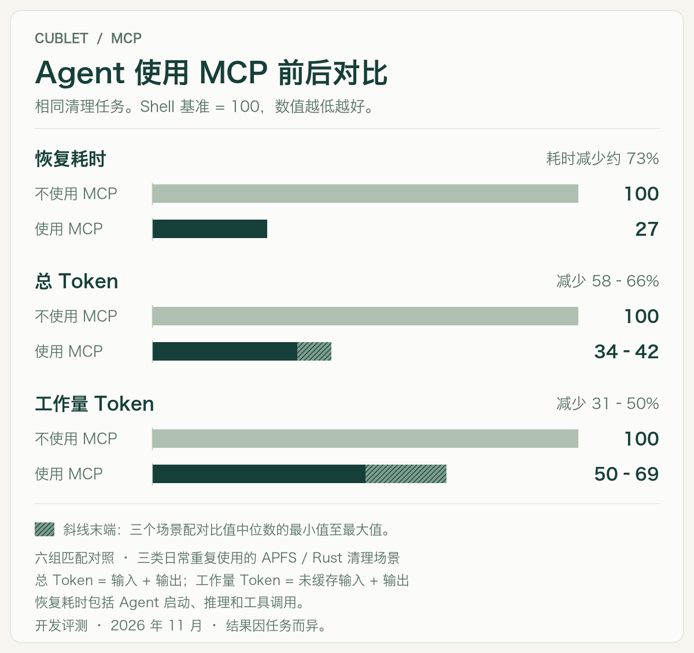

# Cublet

[English](README.md)

**看清 Mac 的空间用在哪里、什么在增长，再决定清理什么。**

Cublet 是一款开源 macOS 磁盘空间分析工具。通过可视化地图查看占用，对比历史扫描，检查应用和关联文件，也可以在你授权后，让 Agent 使用本机清理工具。

[下载 macOS 版](https://cublet.cc/#download) · [发布文章](https://cublet.cc/blog/mac-disk-space/) · [安装与帮助](https://cublet.cc/help/) · [版本记录](https://cublet.cc/changelog/)


**macOS 13+ · Apple 芯片与 Intel · MIT 许可证**

[功能](#功能) · [性能](#性能) · [安装](#安装) · [在 macOS 上构建](#在-macos-上构建) · [参与贡献](#参与贡献)

## 功能

### 看清空间用在哪里

空间浏览器用按占用比例绘制的矩形树图展示磁盘分配空间。选中区块查看路径和占用，逐层进入文件夹，用目录列表检查文件，再通过 Finder 定位项目，帮助你决定如何处理。你可以选择扫描范围，重新扫描获取最新测量，也可以停止正在运行的扫描。

扫描覆盖范围取决于 macOS 权限。可以先使用基础访问范围，或按应用引导开启完全磁盘访问权限。无法访问的位置与不完整的覆盖范围会明确显示，不会将它们当作空文件夹。


### 找出什么发生了变化

「增长」将最新的完整扫描与同一范围内保留的历史测量进行对比。查看哪些文件夹增长，逐层进入对比，并分别检查新增占用、减少占用和净变化。选择保留的基线，就不必仅凭今天最大的文件夹猜测原因。

对比需要兼容的完整扫描。缺少基线时会明确提示；随着共享本机缓存达到预算，较旧的测量可能被淘汰。移动、重命名和硬链接归属变化也可能表现为变化；覆盖有限时会标明已比对的部分。


### 在你授权后，让 Agent 帮忙

Cublet Cleaner 通过 **Model Context Protocol（MCP，模型上下文协议）** 提供本机工具。兼容客户端可以在授权位置内，以可用空间目标为任务，调用原生检查识别可重建的 Rust 构建产物与 Go 构建缓存。正在使用或无法确认安全的内容会受到保护；操作回执区分已删除的分配空间与实际观测到的可用空间。高级连接还提供扫描、历史、预览，以及应用搜索与经过审阅的卸载工具。

连接时，在桌面应用中打开 **AI 连接 → 连接说明**，将设置提示词复制给 Agent。使用当前安装版本提供的可执行文件与参数，由客户端通过 stdio 启动本机进程。应用中也可以查看清理历史。

建立连接不等于授权删除。执行前需要授权具体任务与准确范围。构建缓存回收会永久删除符合条件的产物，后续构建需要重新生成。如果设置选择了废纸篓，这些工具会报告清理模式冲突。应用卸载支持所选的永久删除或废纸篓模式，并要求明确授权具体项目。

扫描与历史保存在 Mac 本机。MCP 在本机运行，但返回给 Agent 的路径、元数据和回执可能由其所选 AI 服务商处理。详见 [MCP 连接说明](https://cublet.cc/help/#mcp)与[隐私说明](https://cublet.cc/privacy/)。

### 检查应用与关联文件

按名称或路径搜索应用。完整路径帮助区分已安装副本、重命名备份和发现的开发构建，让你检查准确的目标副本。确认前，可以审阅应用包，以及可选的关联缓存、偏好设置和应用数据。

共享或归属未核实的数据受到保护，并显示原因。关联识别可能不完整，需要逐项检查可选内容。部分成功时会列出已完成与失败项目，重试前可以再次审阅。

**应用卸载默认永久删除。** 如果希望将所选内容保留在 Finder 废纸篓中，请在设置里选择**移到废纸篓**。废纸篓中的文件仍占用磁盘空间。清空废纸篓是单独的永久操作。

### 可选的 Codex 工具与偏好设置

检查本机 Codex 对话数据、关联的 Git worktree 和清理历史。对话清理使用恢复副本；移除 worktree 的影响不同，确认后可能丢弃本地文件。进行破坏性操作前应停止 Codex，并阅读对应操作的提示。

设置包含英文与简体中文、外观、磁盘访问和应用清理模式。正式版通过更新服务器检查和下载更新；本地打包版本禁用官方更新器。

### 正确理解空间数字

| 术语 | 含义 |
| --- | --- |
| 分配空间占用 | 扫描到的文件系统条目所归属的空间，可能不同于文件大小。 |
| 可用空间 | 实际观测到的卷可用空间，清理期间的并发写入会改变它。 |
| 增长 | 可比较的历史扫描之间，在测量覆盖范围内的变化。 |
| 回收空间 | 清理后观测到的可用空间变化，可能不同于删除的分配空间。 |

APFS 克隆、快照与硬链接可能在删除后继续保留磁盘块。矩形树图描述的是所选范围，可能只覆盖磁盘的一部分。

## 性能

### 完整 Agent 清理任务

在 APFS 上的受控开发评测中，相比同一 Agent 直接使用 Shell，Cublet MCP 的**空间回收用时约少 73%**，**总 token 少 58–66%**，**工作量 token 少 31–50%**。



| 指标 | Cublet MCP，Shell = 100 | 降幅 |
| --- | ---: | ---: |
| 空间回收用时 | 27 | 约 73% |
| 总 token | 34–42 | 58–66% |
| 工作量 token | 50–69 | 31–50% |

六组重复使用配对比较覆盖三种场景：嵌套 Rust worktree、范围改变且存在过期历史，以及持续写入。每种场景取配对 MCP / Shell 比值的中位数。回收用时包含 Agent 启动、推理与工具调用，直到持续恢复可用空间。总 token = 输入 + 输出；工作量 token = 未缓存输入 + 输出。图中范围表示三种场景中位数的跨度，以 Shell = 100 归一化。这些是针对所测任务的开发评测结果，不代表典型性能保证。详见[方法与适用范围](https://cublet.cc/blog/mac-disk-space/#inside-cublet)。

### 原生扫描器开发试测

Rust 核心使用 macOS 批量元数据读取、有界工作线程与本机 SQLite 索引。保留的测量支持导航和对比；全新扫描仍需检查所选范围内的文件系统元数据。

| 模拟目录树 | 完整扫描 | 恢复已保存测量 |
| --- | ---: | ---: |
| 8,329 个文件夹 · 643 个文件条目 | 193 ms | 21 ms |
| 52,009 个文件夹 · 4,003 个文件条目 | 1,128 ms | 75 ms |

数据为每个目录树五个缓存生命周期的中位数，使用一台运行 macOS 26.6.2 的 Mac 和经过优化的开发构建。每次首次扫描前，256 MiB 应用缓存为空，操作系统文件系统缓存已预热；恢复测量使用新的扫描器进程。独立文件系统检查验证了总量。这些用时测量的是所列目录树上的原生扫描器请求，不代表界面延迟或典型真实扫描速度。详见[测试方法](https://cublet.cc/blog/mac-disk-space/#inside-cublet)。

## 安装

从[官方下载页](https://cublet.cc/#download)选择 Apple 芯片或 Intel 版 DMG，打开后将 Cublet 移入「应用程序」。如果不确定版本，可以在 **Apple 菜单 → 关于本机**查看芯片。Cublet 需要 macOS 13 或更高版本。

按应用引导设置磁盘访问权限。完全磁盘访问权限位于**系统设置 → 隐私与安全性 → 完全磁盘访问权限**；如果 macOS 提示，请重新打开 Cublet。详见[安装与故障排查](https://cublet.cc/help/)。

## 在 macOS 上构建

安装 Git、Xcode 命令行工具、Node.js 22 或更高版本，以及包含 Cargo 的稳定版 Rust。通过克隆仓库获取源码，以便打包工具记录准确的源码提交。

```sh
git clone https://github.com/Undertone0809/Cublet.git cublet
cd cublet
npm ci --include=dev
npm run build
cargo test --locked --manifest-path rust-core/Cargo.toml -- --test-threads=1

profile=$(mktemp -d "${TMPDIR:-/tmp}/cublet-dev.XXXXXX")
MSM_DISK_CACHE_ROOT="$profile/cache" CODEX_HOME="$profile/codex" \
  npm run electron:dev -- --user-data-dir="$profile/profile"
```

隔离配置可以在与已安装版本并行测试时，将开发数据分开保存。

构建未签名的本地应用包：

```sh
rustup component add rust-docs
CSC_IDENTITY_AUTO_DISCOVERY=false npm run electron:package
```

Rust 文档组件提供应用包中附带的标准库许可证文件。本地应用包禁用官方更新器。如需交叉构建，安装对应的 Rust target，并设置 `CUBLET_ARCH=arm64` 或 `CUBLET_ARCH=x64`。

## 参与贡献

[CONTRIBUTING.md](CONTRIBUTING.md) 说明测试与问题反馈方式。安全漏洞请按照[私密报告说明](SECURITY.md)提交。Cublet 是独立项目。

Cublet 自有代码使用 [MIT 许可证](LICENSE)。源码与发行包保留相应的[第三方声明](THIRD_PARTY_NOTICES.md)。
